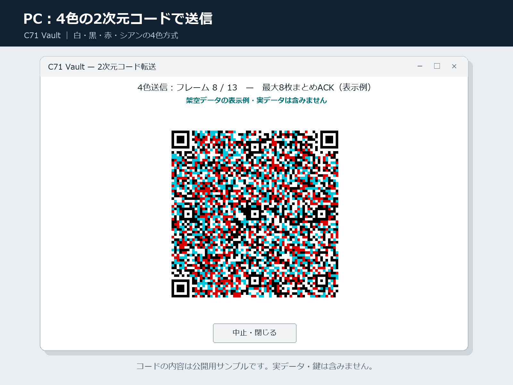
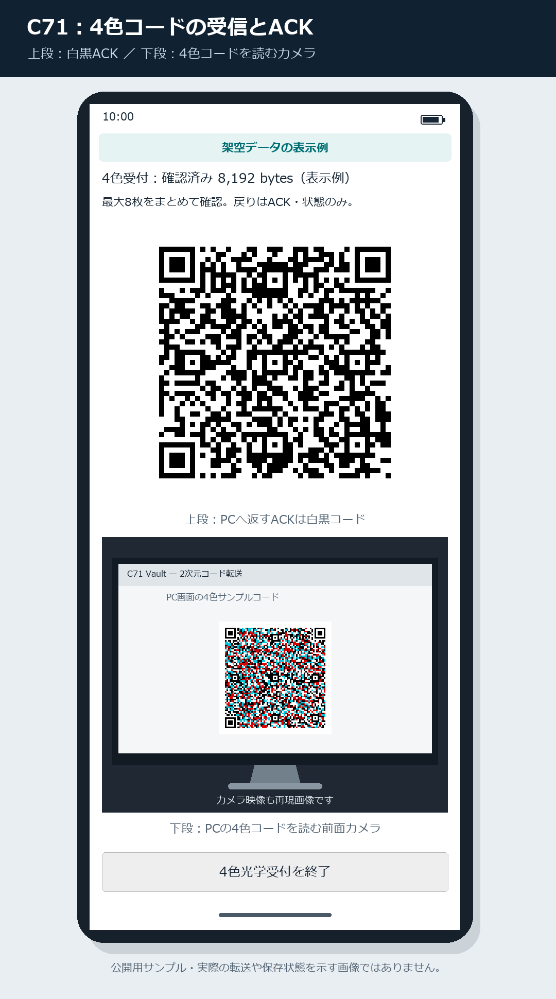
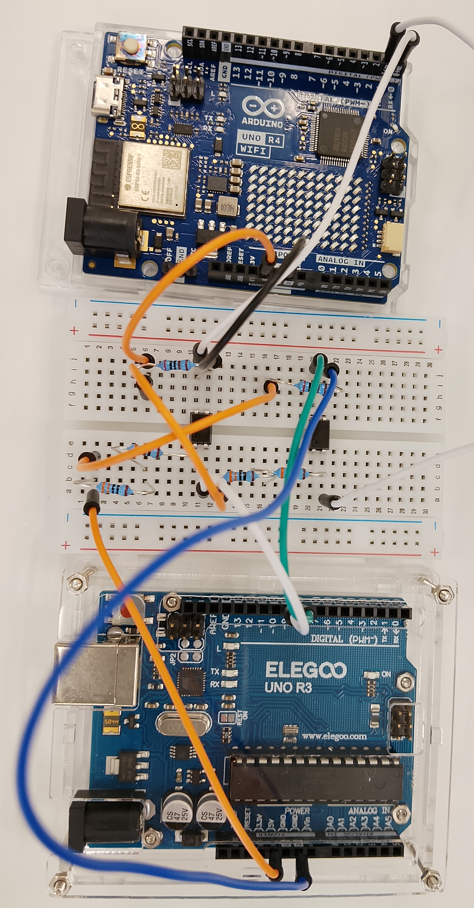

# C71 Vault — Encrypted Backups over USB, Optical Codes, and an Optocoupler Serial Link

**Initial public release · Windows 0.5.3 · Android 0.5.0**

This is the first public release of C71 Vault. The version numbers reflect development and testing before publication; no earlier versions of this system have been published on GitHub.

C71 Vault uses a realme C71's available storage to keep encrypted, versioned backups from a Windows PC. Files are encrypted on the PC and stored in the Android app's private storage. The PC-facing protocol provides no operation to delete or overwrite existing backups.

The system has been tested repeatedly on the actual hardware. A recorded transfer through two Arduino boards and two optocouplers returned a signed acknowledgement confirming storage and read-back verification on the C71. Backups sent through both the optical and optocoupler paths have subsequently been restored over USB/MTP, with file hashes matching their originals.

## Three transfer methods

| Method | Data path | Return path |
|---|---|---|
| USB/MTP | USB transfer folder → C71 private storage | Signed responses over USB |
| Optical | PC display → C71 camera; monochrome or four-color codes | Signed ACK/status codes displayed by C71 |
| MIDI/SysEx serial | PC USB → UNO R3 → optocoupler UART → UNO R4 WiFi → USB serial over C71 USB-C/OTG | Signed ACK/status through USB serial and a second optocoupler |

The optical and MIDI interfaces accept new backups and return acknowledgements/status. They expose no backup export, history listing, recovery-key management, deletion, retention changes, or arbitrary-command interface. Initial PC registration, recovery-key custody setup, and restoration use USB/MTP.

C71 acts as the USB host for the UNO R4 WiFi's USB CDC serial interface through an OTG adapter. Wi-Fi is not used. In the optocoupler transfer configuration, R3 is USB-connected to the PC and R4 is USB-connected to C71; the two sides must not share a ground or another conductive connection if ground separation is intended. Connecting R4 or C71 back to that PC creates a separate development/restoration configuration and does not preserve that separation.

## Backup workflow

1. On Windows, select files and folders or drag them into the application. Word documents, images, text files, and other file types are supported.
2. Select a recovery-key file and choose USB, optical, or MIDI transfer.
3. On C71, choose a folder category within app-private storage, select the corresponding receiver, and start receiving.
4. Start the transfer on Windows.

**Sending all bytes is not treated as backup success.** C71 receives into staging, verifies the size and SHA-256, stores the archive, reads it back, verifies it again, and commits it. Windows reports success only after validating the signed completion response.

## Recovery and retention

### Private storage and the USB handoff folder

The authoritative archives are stored under Android's internal `getFilesDir()/vault/archives`, not in an MTP-visible directory or external `Android/data`. A separate folder selected on the phone, such as `Documents/C71Vault`, is the USB handoff area: Windows accesses it over MTP and the running Android app accesses it through the Storage Access Framework. To list or restore backups, Windows places a signed request in that folder. The app verifies the registered PC's signature and returns a signed listing or, for an export request, checks the stored archive's SHA-256 and copies its encrypted `.c71b` file to `x-<request-id>.c71b` in the handoff folder. Windows retrieves and verifies that copy and decrypts it locally. A subsequent authenticated cleanup acknowledgement removes the handoff copy and response, leaving the private archive intact; an interrupted exchange can leave temporary files in the handoff folder. MTP never directly browses the private vault.

Recovery-key capsules are stored separately under `getFilesDir()/vault/recovery-keys`; their wrapping private key is held in Android Keystore with device-credential authentication required. After authentication on C71, key recovery rewraps the key for the requesting PC's temporary public key. Only that encrypted capsule passes through the handoff folder; a plaintext recovery key is not written there. See [Vault.java](android/app/src/main/java/jp/c71/vault/Vault.java) and [RecoveryKeys.java](android/app/src/main/java/jp/c71/vault/RecoveryKeys.java).

### History, recovery, and cleanup

- Successful MIDI backups appear in the PC history immediately and remain visible after restarting the application. History distinguishes verified MIDI commit receipts, cached USB history, and the latest USB-verified listing. Refreshing over USB checks the phone's current contents.
- To restore a backup, connect C71 directly to the PC over USB/MTP, refresh the history, select the archive and its recovery-key file, and choose a destination. The application creates a new restore folder without overwriting existing files.
- Archives use AES-256-GCM encryption.
- A recovery key can also be held on C71, outside the MTP-visible folder. Key custody and recovery require authentication on the phone. A newly registered PC can recover a previously stored key after the original PC is reset.
- Retention rules propose cleanup candidates: retain every version for the latest 30 days, one per day for days 31–180, one per week thereafter until one year, and one per month from one year onward.
- Important versions are excluded from retention cleanup. Cleanup requires review and authentication on C71.
- Low free space triggers a warning, with a default threshold of 15%. It does not trigger automatic deletion.

## Four-color optical transfer

The four-color optical mode combines three techniques:

1. **Binary packets:** up to 1,024 bytes of backup payload per displayed data frame, compared with 512 bytes in the monochrome mode.
2. **Four colors:** two QR bit planes are combined into white, black, red, and cyan. C71 reconstructs both layers with the project's decoder.
3. **Grouped acknowledgements:** up to eight frames form a receive window. A bitmap ACK identifies missing frames so that only those frames need to be retransmitted.

Return ACK/status codes remain monochrome. C71 displays its ACK above the front-camera preview to help align it with a camera mounted above the PC display. This is a project-specific format, not JAB Code or HCC2D. Doubling payload per frame does not imply twice the measured transfer speed.

### PC: displaying a four-color data frame

### C71: displaying an ACK and reading the PC code

These are reconstructed UI illustrations based on the implementation, not screenshots of a live transfer. The codes contain public demonstration text only, with no real files, recovery keys, signatures, or device identifiers. The camera preview and progress values are illustrative.

In a recorded camera/display test, C71 stored a 13,208-byte encrypted archive using 13 data frames in two receive windows of eight and five. The final signed ACK and stored hash were verified. After USB/MTP retrieval, both restored files matched their original SHA-256 hashes. The approximately 170-second session included alignment, reading waits, and retransmissions; it is not a throughput benchmark. See [OPTICAL_V2.md](OPTICAL_V2.md) and [VALIDATION.md](VALIDATION.md).

## Prototype hardware

Cropped original photograph: UNO R4 WiFi at the top, the breadboard in the center, and UNO R3 at the bottom. USB cables are disconnected in this photograph. [Breadboard close-up](docs/images/02-optocoupler-breadboard-detail.png).

## Hardware test results

Tested with a realme C71, UNO R3, UNO R4 WiFi, and **two PS817C optocouplers**, identified by their package markings. One carries forward data and the other carries returning ACK/status. Each LED input uses two 330-ohm resistors in series (660 ohms); each transistor output uses a 2-kilohm pull-up. The circuit is assembled on a breadboard.

- Generated 18-byte, 1 KiB, and 64 KiB payload streams passed in both directions between the Arduino boards, with matching encoded-stream SHA-256 hashes.
- A Word document was encrypted into an **11,838-byte archive** and sent from the Windows UI through the optocoupler link to C71.
- C71 returned a signed **`committed`** acknowledgement at sequence **25**. Windows verified the expected session, size, hash, and device signature. A separate local check also verified the stored receipt's signature; this was not a third-party audit. The published [sanitized verification report](validation/normal-midi-commit-result.json) records the result, but the original signed receipt is not included, so readers cannot repeat that particular signature check from the report alone.

**The working inter-board speed is currently 9,600 baud.** USB serial remains at 115200 baud. The payload uses MIDI SysEx framing and seven-bit encoding, but the working electrical link is not a standard 31,250-baud MIDI connection. **At 31,250 baud, this PS817C breadboard circuit produced missing or corrupted bytes; the issue remains unresolved.** This observation does not establish the PS817C's intrinsic speed limit or identify the electrical cause. The Arduino boards use USB serial rather than USB MIDI-class enumeration.

The bridge firmware buffers each bounded SysEx frame before forwarding it to UART.

On 2026-10-01, the phone returned a signed history containing 10 archives. A previously MIDI-transferred Word document was retrieved over USB/MTP and restored successfully; its SHA-256 matched the original document.

The Windows 0.5.3 build included in this initial release passed [90 Python tests](validation/python-tests-v053.txt), the [packaged application's offline runtime self-test](validation/exe-self-test-v053.json), and a [53-message asynchronous native drag-and-drop regression](validation/exe-drop-v053.json). Test dates, recorded environments, reproduction commands, and evidence limitations are indexed in [VALIDATION.md](VALIDATION.md#publication-evidence-index). A [SHA-256 manifest](validation/PUBLICATION_SHA256SUMS.txt) identifies the published evidence files and the current executable/APK. These checksums identify artifacts; they do not independently prove that a test ran or retrospectively establish the binaries used in earlier tests.

## Scope and limitations

This is an experimental backup system. It depends on Android's app isolation, device lock, and OS integrity. Disable USB debugging for protected operation. Phone loss, failure, app-data deletion, or loss of all recovery-key copies can still prevent recovery; keep independent copies.

Two optocouplers provide separate data and ACK paths; this is not a physically one-way data diode. Connecting both boards to the same PC bypasses ground isolation. Electrical isolation ratings have not been validated.

The system has undergone repeated hardware transfer tests. The 11,838-byte result above is one documented example, not the total extent of testing. The MIDI path is designed for backup ingestion with signed ACK/status responses; restoration uses the separate USB/MTP workflow. Current encrypted-input limits are 8 GiB for USB and 16 MiB for optical/MIDI.

## Downloads and documentation

Download the Windows/Android bundle from this repository's **Releases** page. For Japanese operating instructions, see [README.ja.md](README.ja.md).

- Distribution archive: `C71Vault-0.5.3-Windows-Android.zip`
- Windows: `windows/C71Vault-0.5.3/C71Vault.exe` — keep the accompanying `_internal` directory.
- Android: `C71Vault-0.5.0.apk`
- Source archive: `C71Vault-source.zip`

See [TRANSFER_UI.md](TRANSFER_UI.md) for operation, [arduino/README.md](arduino/README.md) for bridge firmware, [VALIDATION.md](VALIDATION.md) for test evidence, [SECURITY.md](SECURITY.md) for the security model, and [THIRD_PARTY.md](THIRD_PARTY.md) for dependency notices.

## Project license

No license is specified for the original C71 Vault code at this time. Third-party components retain their respective licenses; see [THIRD_PARTY.md](THIRD_PARTY.md) and [licenses/](licenses/).
